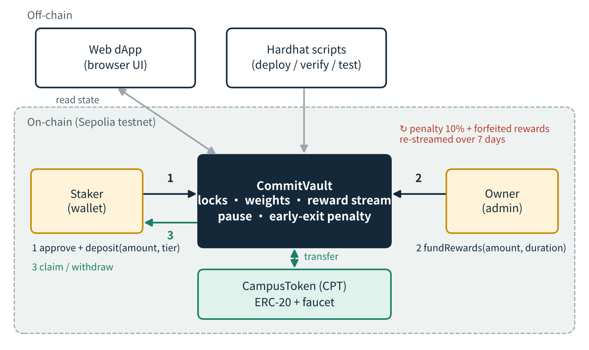

# CommitVault

> Commitment-based staking vault on Ethereum (Sepolia testnet). Lock tokens for 30 / 90 / 180 days, earn a weighted share of a streaming reward pool, and if you leave early your 10% penalty is paid to the savers who stay.

CDS528 Group Assignment – Blockchain DeFi Smart Contract Development (Lingnan University).
**Testnet only. The token has no real value. Do not use real funds.**

| | |
|---|---|
| Team | _TODO: group name / ID and member names_ |
| Sepolia – CampusToken | _TODO: address_ · [Etherscan (verified)](https://sepolia.etherscan.io/address/TODO#code) |
| Sepolia – CommitVault | _TODO: address_ · [Etherscan (verified)](https://sepolia.etherscan.io/address/TODO#code) |
| Live demo (browser, no wallet) | open `frontend/index.html` |

## 1. What it does

| Lock tier | Period | Reward weight |
|---|---|---|
| 0 | 30 days | 1.0× |
| 1 | 90 days | 1.5× |
| 2 | 180 days | 2.5× |

* Rewards stream per second to all positions in proportion to `amount × multiplier`.
* **Early exit**: you get 90% of principal back and forfeit unclaimed rewards; the penalty and forfeited rewards are re-streamed (7 days) to stakers who are still locked.
* The owner can only **fund rewards** and **pause new deposits**. The owner has no function that touches user principal, and `withdraw`/`claim` can never be paused.



## 2. Repository layout

```
contracts/CampusToken.sol   ERC-20 test token + daily faucet
contracts/CommitVault.sol   the vault (locks, weighted rewards, penalty, pause)
test/CommitVault.test.js    Hardhat tests (14)
test/model.check.js         sanity checks of the JS mirror used by the dApp
scripts/deploy.js           one-command deployment (local or Sepolia)
scripts/build-frontend.js   inlines vault-model.js into frontend/index.html
frontend/index.html         single-file web dApp (demo mode)
docs/                       report, slides, screenshots
```

## 3. Prerequisites

* Node.js 18+ (20 or 22 recommended) and npm
* (Optional, for the scan) Python 3 + `pip install slither-analyzer`
* For Sepolia: a **throw-away** wallet with Sepolia ETH (any faucet), an RPC URL (Infura/Alchemy) and an Etherscan API key

## 4. Install, compile, test

```bash
git clone https://github.com/<team>/commitvault.git
cd commitvault
npm install
npx hardhat compile
npx hardhat test                    # 14 tests
REPORT_GAS=true npx hardhat test    # gas table
npx hardhat coverage                # optional
npm run model:check                 # JS mirror sanity checks (no dependencies)
```

## 5. Deploy to Sepolia and verify

```bash
cp .env.example .env     # fill SEPOLIA_RPC_URL, PRIVATE_KEY (test wallet only!), ETHERSCAN_API_KEY
npm run deploy           # = hardhat run scripts/deploy.js --network sepolia
```

The script deploys `CampusToken` (1,000,000 CPT) and `CommitVault`, seeds 10,000 CPT of rewards over 30 days and writes `deployments/sepolia.json`. It prints the two verify commands, for example:

```bash
npx hardhat verify --network sepolia <TOKEN> 1000000000000000000000000
npx hardhat verify --network sepolia <VAULT> <TOKEN>
```

Paste the Etherscan links in the table at the top of this file. Local dry run: `npm run deploy:local`.

## 6. Run the web dApp

```bash
npx serve frontend        # or just double-click frontend/index.html
```

The page runs a JavaScript copy of the vault logic (same integer maths) so it works without a wallet: pick Alice / Bob / Owner, get faucet tokens, lock, skip time, claim, exit early. To rebuild the single file after editing `frontend/index.template.html` or `vault-model.js`: `node scripts/build-frontend.js`.

## 7. Security

* OpenZeppelin `ReentrancyGuard`, `Ownable`, `Pausable`, `SafeERC20`, `SafeCast`; Solidity 0.8.24 checked arithmetic.
* Checks-effects-interactions; no loops over users; max 20 positions per wallet.
* Invariant tested: vault token balance = total principal + reward reserve.
* Static analysis: `npm run slither` — _TODO: paste summary/screenshot in the report_.
* Known limits: one fixed token (no fee-on-transfer/rebasing tokens); stream rewards produced while nobody is staked stay unallocated; owner is a single key (use a multisig for any real deployment). Contracts are **immutable** by design (no proxy) for simplicity and to remove upgrade risk.

## 8. AI-assistance disclosure

An AI assistant (Claude, Anthropic) helped draft the contracts, tests, front-end and documentation. The team must review, compile, test and scan everything before submission and takes responsibility for the final code.

## 9. Licences and credits

* Project code: MIT (see `LICENSE`).
* [OpenZeppelin Contracts](https://github.com/OpenZeppelin/openzeppelin-contracts) 5.0.2 – MIT.
* Reward-accumulator idea: Synthetix `StakingRewards` – MIT (re-implemented, not copied).
* Tutorials: <https://ethereum.org/developers/tutorials/>
